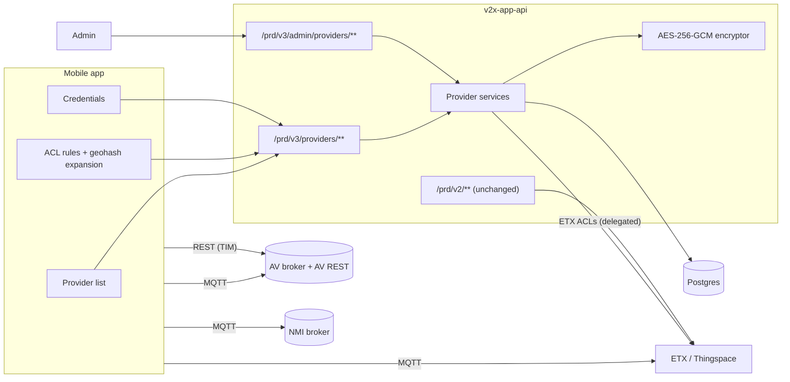
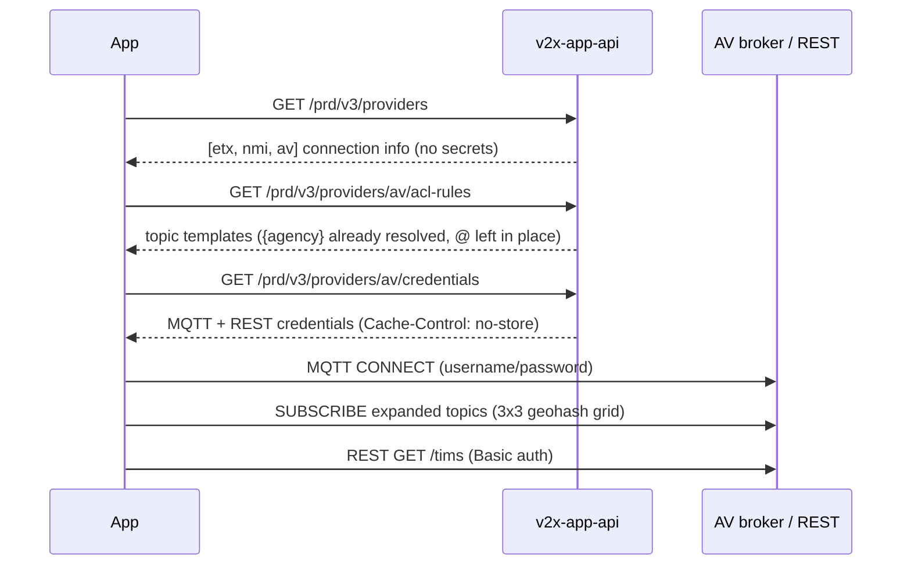
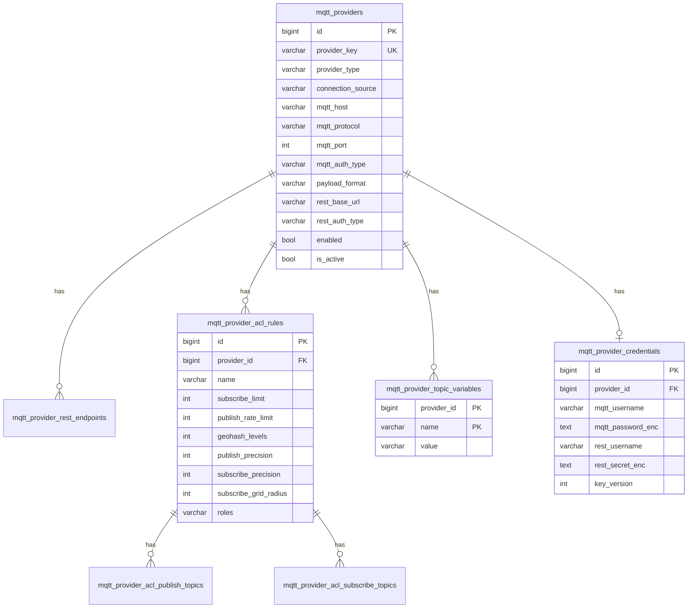

# Design: Runtime MQTT Provider Configuration (AV, ETX, NMI)

| | |
|---|---|
| **Status** | Draft, open for peer review |
| **Component** | v2x-app-api |
| **Scope** | API only. Mobile app changes are tracked separately. |
| **Reviewers** | Please comment inline on the PR. Open questions are listed in [section 14](#14-open-questions). |

## 1. Background

Today the mobile app connects to one MQTT broker, ETX/Thingspace:

- The broker URL comes from `POST /prd/v2/connection` (`ConnectionResponse.MqttURL`).
- Topic permissions come from `GET /prd/v2/acl-rules`. This call proxies ETX `/api/v1/device-roles/vendor` and can be narrowed by `AclRulesFilter`.
- Everything else (topic grammar, payload formats, message types) is hardcoded, in the app or in `AclRulesFilter` constants.

Two more brokers have to be supported:

| | **AV** (primary target) | **NMI** (National Mobility Interchange) |
|---|---|---|
| MQTT auth | Username and password | Anonymous |
| Endpoint | `v2x.aitoms.net`, `tcp:1883` | `mqtt.us.mobilityinterchange.com`, `tcp:1883` / `ws:80` (test: `mqtt.development.v2x.isscms.com`) |
| Topic layout | `{MSG}/unsigned/J2735/{agency}/{geohash path}`, except TIM, which is `TIM/unsigned/J2735/{geohash path}` | `v1/g32/{geohash path}/{messageId}` |
| Geohash path | One character per topic level, precision 7 | One character per topic level, precision 7 |
| Payload | Unsigned UPER | IEEE 1609.2-signed UPER |
| REST API | TIM REST API that the app calls directly, with credentials | None |

The app needs AV's MQTT credentials and AV's REST credentials. Those can't be compiled into the app, so they have to be delivered securely at runtime. AV topics also contain an agency level (for example `DDOT`) that must be changeable without an app release.

## 2. Goals and non-goals

**Goals**

1. v2x-app-api becomes the runtime source of truth for:
   - which MQTT providers the app should use
   - how to connect to each one
   - which topics the app may publish to and subscribe to
   - each provider's credentials
2. AV is fully supported. ETX and NMI are also described as providers.
3. Adding or changing a provider is a configuration change, not an app release.
4. Provider-specific topic values, such as the AV agency, can be configured without code changes.
5. Credentials are encrypted at rest. They are never shown in admin views or logs.
6. Every existing v2 endpoint behaves exactly as it does today.

**Non-goals**

- Mobile app changes to use the new API.
- Obtaining the AV credentials from the AV provider.
- Deprecating or moving existing v2 endpoints.
- Per-user or per-device broker credentials. Each provider has one shared set (see [section 13](#13-alternatives-considered)).
- Proxying broker traffic or AV REST traffic through v2x-app-api.

## 3. Overview



Startup sequence for the app (the app-side work is not part of this ticket):



## 4. Provider model

A **provider** is one MQTT broker, plus an optional REST API, that the app can use.

| Field | Description |
|---|---|
| `key` | Stable lowercase identifier (`etx`, `nmi`, `av`). Used in URLs. |
| `type` | `ETX`, `NMI`, `AV` or `GENERIC`. Tells the app which provider-specific behaviour, if any, applies. |
| `displayName`, `priority`, `enabled` | Presentation, ordering, and on/off switch. |
| `mqtt.connectionSource` | `STATIC`: use the host, port and protocol stored here. `ETX_CONNECTION`: keep using `POST /prd/v2/connection`, which handles certificate provisioning. |
| `mqtt.host`, `protocol`, `port`, `tls` | Broker endpoint. `protocol` is one of `tcp`, `ssl`, `ws` or `wss`. |
| `mqtt.authType` | Left out when the broker is anonymous. Otherwise `USERNAME_PASSWORD` or `ETX_CERT`. |
| `payloadFormat` | `GEO_ROUTED_PROTO_UNSIGNED_UPER` (ETX), `IEEE1609_2_SIGNED_UPER` (NMI) or `UNSIGNED_UPER` (AV). |
| `rest.baseUrl`, `rest.authType`, `rest.endpoints` | Optional REST API. `authType` is one of `NONE`, `BASIC`, `API_KEY`, `BEARER` or `OAUTH2_CLIENT_CREDENTIALS`. `endpoints` maps names to paths, for example `tim` → `/tims`. |

The REST auth model is generic so that it covers whatever AV ends up requiring. Only AV has a REST API today.

## 5. Topic templates

### 5.1 Syntax

ACL topics stay in **ETX ACL syntax**, so the app's existing ACL parsing keeps working. Two additions are made.

| Token | Meaning | Expanded by |
|---|---|---|
| `\|` | Alternatives within one level. `20\|32` becomes one topic per alternative. This is unchanged from ETX. | App |
| `+`, `*` | Single-level wildcard. `*` is the ETX form and is treated the same as `+`. | Broker |
| `#` | Multi-level wildcard. It may only be the last level. | Broker |
| **`@`** *(new)* | **Geohash path.** A whole level that expands into the geohash characters, separated by `/`. | App |
| **`{name}`** *(new)* | **Topic variable.** A whole level replaced with a configured value, for example `{agency}` → `DDOT`. | API, before the response is sent |

The app never sees `{name}` placeholders, only `@`.

### 5.2 Topic variables (`{agency}`)

- **Value precedence** (highest first):
  1. A per-provider value set through the admin API (`mqtt_provider_topic_variables`).
  2. The deployment default from configuration, for example `mqtt.topic-variables.av.agency=${AV_TOPIC_AGENCY:DDOT}`.
- **Allowed values.** A value must be a single literal topic level. It may not contain `/ + # * | { } @`, leading or trailing whitespace, or be empty. This is enforced in both the API and a DB `CHECK` constraint.
- **Missing values.** A template that uses a variable with no value is a server configuration error. The admin API rejects rule saves that would leave a variable unresolved, and the mobile endpoint fails closed: it logs the error and returns an error response rather than an unresolved topic. See [Q3](#14-open-questions).
- **Seeded AV topics:**
  - `PSM|BSM|SDSM|SPAT|MAP` → `{MSG}/unsigned/J2735/{agency}/@`
  - `TIM` → `TIM/unsigned/J2735/@`. TIM has no agency level.

  Because TIM has a different shape, AV topics are listed one per message type instead of being combined with `|` in the first level.

### 5.3 Geohash expansion in the app

Each rule includes a `geohash` block:

```json
{ "symbol": "@", "levels": 7, "publishPrecision": 7, "subscribePrecision": 7, "subscribeGridRadius": 1 }
```

- **Publish.** Compute the geohash of the event location at `publishPrecision` and substitute it for `@`, one character per level.
  - If a message's extent covers more than one cell, it is published once per cell, using the same message ID each time. This is NMI's rule.
- **Subscribe.** This mirrors what the app does for ETX today.
  1. Take the device's geohash at `subscribePrecision`.
  2. Add its neighbours out to `subscribeGridRadius` rings. Radius 1 gives a 3×3 grid of 9 cells.
  3. Expand each cell into every subscribe template.
  4. When the device enters a new cell, unsubscribe from cells that left the grid and subscribe to the new ones.
- **Padding.** If `subscribePrecision < levels`, the remaining levels are filled with `+`. With the defaults (7 = 7) there is no padding.

Example, centre cell `dp3wjzb`:

| Template | Expanded centre-cell topic |
|---|---|
| NMI `v1/g32/@/31` | `v1/g32/d/p/3/w/j/z/b/31` |
| AV `MAP/unsigned/J2735/{agency}/@` (agency `DDOT`) | `MAP/unsigned/J2735/DDOT/d/p/3/w/j/z/b` |
| AV `TIM/unsigned/J2735/@` | `TIM/unsigned/J2735/d/p/3/w/j/z/b` |

Each of these is repeated for the 8 neighbouring cells.

### 5.4 Subscription limit

`subscribeLimit` is the number of MQTT subscriptions the app actually opens:

```
per template: (product of | alternatives) × ((2r + 1)² if it contains @, else 1)
total = sum over all subscribe templates
```

| Seed rule | Subscribe templates | Count |
|---|---|---|
| `nmi.mobile.default` | `v1/g32/@/31\|19\|18\|41` | 4 × 9 = **36** |
| `av.mobile.default` | 6 topics, each containing `@` | 6 × 9 = **54** |

### 5.5 Validation, applied when a rule is saved

- `@` appears at most once per topic and fills a whole level. `{name}` placeholders also fill whole levels.
- `#` only appears as the last level.
- Publish topics contain no wildcards. `|` alternatives are allowed.
- `publishPrecision` and `subscribePrecision` are each between 1 and `levels`, and `levels` is at most 12. `subscribeGridRadius` is between 0 and 2.
- `subscribeLimit` is at least the expanded count from [section 5.4](#54-subscription-limit).
- Every `{name}` used has a value (see [section 5.2](#52-topic-variables-agency)).

Errors return HTTP 400 through `GlobalExceptionHandler`.

### 5.6 J2735 message IDs

The NMI topic ends in the `DSRCmsgID` integer. The mapping is stored in a reference table (`j2735_message_ids`) so admin tooling and docs don't need hardcoded numbers:

| BSM | PSM | TIM | SPAT | MAP | SDSM |
|---|---|---|---|---|---|
| 20 | 32 | 31 | 19 | 18 | 41 |

This table is kept separate from `message_types`, which is the foreign-key domain for deposits and has a different meaning.

## 6. API

### 6.1 Versioning

- **Nothing under `/prd/v2/**` changes.** That covers paths, payloads and behaviour, so current app builds are unaffected.
- **All new endpoints live under `/prd/v3/**`** and are served by the same application, in a new `usdot.v2x.app.api.v3.*` package. A shared `ApiPaths` constants class holds `V2` and `V3`.
- **v3 reuses the v2 services.** For example, `GET /prd/v3/providers/etx/acl-rules` calls the same `RegistrationApi.getDeviceRoles()` and `AclRulesFilter` as `GET /prd/v2/acl-rules`, so the ETX logic has one source of truth. A test asserts that both return identical bodies.
- **No infrastructure changes are needed.** `AccessController` (`/**`), `RequestBodyCaptureFilter` and `ErrorLoggingService` (both match on the `/prd/` prefix) already cover `/prd/v3/**`.
- **OpenAPI.** There is still one springdoc document, so the `generateOpenApiDocs` output (`docs/v2x-app-api-openapi.json`) keeps building. The new controllers are tagged `Providers (v3)` and `Provider Admin (v3)`.

### 6.2 Mobile endpoints

These allow `ADMIN`, `DEPOSITOR` and `USER`, the same as `/prd/v2/acl-rules`.

| Method | Path | Returns |
|---|---|---|
| GET | `/prd/v3/providers` | Enabled providers ordered by `priority`, with connection and REST info. **No secrets.** |
| GET | `/prd/v3/providers/{key}/acl-rules` | ACL rules in the ETX shape plus `geohash`, filtered to the caller's roles, with variables resolved. |
| GET | `/prd/v3/providers/{key}/credentials` | Decrypted credentials, sent with `Cache-Control: no-store`. Returns 404 when the provider has none (for example NMI). |

<details>
<summary><code>GET /prd/v3/providers</code> example</summary>

Null fields are left out of the response.

```json
[
    {
        "key": "etx",
        "type": "ETX",
        "displayName": "ETX",
        "enabled": true,
        "priority": 0,
        "mqtt": { "connectionSource": "ETX_CONNECTION", "authType": "ETX_CERT" },
        "payloadFormat": "GEO_ROUTED_PROTO_UNSIGNED_UPER",
        "aclRulesPath": "/prd/v3/providers/etx/acl-rules"
    },
    {
        "key": "nmi",
        "type": "NMI",
        "displayName": "OmniTrust National Mobility Interchange",
        "enabled": true,
        "priority": 10,
        "mqtt": { "connectionSource": "STATIC", "host": "mqtt.us.mobilityinterchange.com", "protocol": "tcp", "port": 1883, "tls": false },
        "payloadFormat": "IEEE1609_2_SIGNED_UPER",
        "aclRulesPath": "/prd/v3/providers/nmi/acl-rules"
    },
    {
        "key": "av",
        "type": "AV",
        "displayName": "AV",
        "enabled": true,
        "priority": 20,
        "mqtt": { "connectionSource": "STATIC", "host": "v2x.aitoms.net", "protocol": "tcp", "port": 1883, "tls": false, "authType": "USERNAME_PASSWORD" },
        "rest": { "baseUrl": "https://…", "authType": "BASIC", "endpoints": { "tim": "/tims" } },
        "payloadFormat": "UNSIGNED_UPER",
        "aclRulesPath": "/prd/v3/providers/av/acl-rules",
        "credentialsPath": "/prd/v3/providers/av/credentials"
    }
]
```

`credentialsPath` is only included when credentials are stored for that provider.
</details>

<details>
<summary><code>GET /prd/v3/providers/av/acl-rules</code> example (agency = DDOT)</summary>

```json
[
    {
        "name": "av.mobile.default",
        "subscribeLimit": 54,
        "publishRateLimit": 10,
        "geohash": { "symbol": "@", "levels": 7, "publishPrecision": 7, "subscribePrecision": 7, "subscribeGridRadius": 1 },
        "publish": [
            "PSM/unsigned/J2735/DDOT/@",
            "BSM/unsigned/J2735/DDOT/@"
        ],
        "subscribe": [
            "PSM/unsigned/J2735/DDOT/@",
            "BSM/unsigned/J2735/DDOT/@",
            "SDSM/unsigned/J2735/DDOT/@",
            "SPAT/unsigned/J2735/DDOT/@",
            "MAP/unsigned/J2735/DDOT/@",
            "TIM/unsigned/J2735/@"
        ]
    }
]
```

The NMI rule has the same shape, with `publish: ["v1/g32/@/20|32"]`, `subscribe: ["v1/g32/@/31|19|18|41"]` and `subscribeLimit: 36`.
</details>

<details>
<summary><code>GET /prd/v3/providers/av/credentials</code> example</summary>

```json
{
    "provider": "av",
    "mqtt": { "username": "…", "password": "…" },
    "rest": { "authType": "BASIC", "username": "…", "secret": "…" },
    "updatedAt": "2026-11-10T12:00:00Z"
}
```

Other REST auth types fill in the fields they need: `clientId`, `tokenUrl` and `scope` for OAuth2 client credentials, or `apiKeyHeader` for an API key.
</details>

### 6.3 Admin endpoints (`ROLE_ADMIN` only)

These follow the same conventions as `VendorLimitsRestController`: POST upserts, and DELETE soft-deletes (`is_active = false`).

| Method | Path | Purpose |
|---|---|---|
| GET | `/prd/v3/admin/providers` | List all providers, including disabled ones. |
| GET | `/prd/v3/admin/providers/{key}` | Get one provider. |
| POST | `/prd/v3/admin/providers` | Create a provider, or upsert it by `key`. |
| DELETE | `/prd/v3/admin/providers/{key}` | Soft-delete a provider. |
| GET / POST | `/prd/v3/admin/providers/{key}/acl-rules` | List rules, including role scoping, or upsert a rule by `name` (validated as in [section 5.5](#55-validation-applied-when-a-rule-is-saved)). |
| DELETE | `/prd/v3/admin/providers/{key}/acl-rules/{name}` | Soft-delete a rule. |
| GET | `/prd/v3/admin/providers/{key}/topic-variables` | List the effective values, each marked as coming from the DB or from configuration. |
| PUT / DELETE | `/prd/v3/admin/providers/{key}/topic-variables/{name}` | Set a DB override, or remove it and fall back to the configured default. |
| GET | `/prd/v3/admin/providers/{key}/credentials` | **Masked** view: usernames, `hasPassword` / `hasSecret`, last 4 characters (for example `••••1234`), and `updatedAt`. |
| PUT | `/prd/v3/admin/providers/{key}/credentials` | Set or rotate credentials. This endpoint is write-only. |
| DELETE | `/prd/v3/admin/providers/{key}/credentials` | Remove credentials. |

### 6.4 Error behaviour

| Condition | Status |
|---|---|
| Unknown or disabled provider key on a mobile endpoint | 404 |
| Provider has no stored credentials | 404 |
| Invalid topic template or limit, or an invalid variable value | 400 |
| Non-admin calls an admin endpoint | 403 |
| Encryption key missing, or stored value can't be decrypted with the current key | 503 |
| ETX upstream failure (ETX provider only) | Same as `/prd/v2/acl-rules` today |

## 7. Data model

Delivered as migration `010_add_mqtt_providers.sql`. It follows the style of 001–009: wrapped in `BEGIN`/`COMMIT`, idempotent, and using the `update_updated_at_column()` trigger. The same DDL goes into `init-db.sql`.



Notes:

- **Child tables instead of JSONB.** Topics, REST endpoints and variables are child tables mapped with `@ElementCollection`, following `models/Path.java`, rather than JSONB columns. This keeps the `openapi` profile working, because it boots on H2 with `create-drop`.
- **DB constraints back up the API validation:**
  - key format `^[a-z0-9-]+$`
  - protocol and port ranges
  - an enabled `STATIC` provider must have a host, protocol and port
  - geohash precision and radius bounds
  - topic-variable value format
- **Seed data** never overwrites admin edits. Rows are inserted with `ON CONFLICT DO NOTHING`, and child rows are only seeded when this run created the provider. The seeds are:
  - `etx`: `ETX_CONNECTION`. Its ACLs come from ETX, so no rules are seeded.
  - `nmi`: the production host, plus `nmi.mobile.default`.
  - `av`: seeded **disabled**, plus `av.mobile.default`. An admin adds the REST base URL and credentials, then enables it.
  - No secrets are ever seeded.
- **Role scoping.** `roles` is a nullable CSV of `USER`/`DEPOSITOR`/`ADMIN`. Null means the rule applies to every role.

## 8. Credential security

| Concern | Design |
|---|---|
| **At rest** | Credentials are encrypted with AES-256-GCM using JDK `javax.crypto`, so no new dependency is needed. Each value gets a random 12-byte IV and a 128-bit tag. The stored format is `v{keyVersion}:base64(iv‖ciphertext‖tag)`. Encryption is applied by a JPA `AttributeConverter` on the `*_enc` columns. Usernames are not encrypted. |
| **Key** | `PROVIDER_CREDENTIALS_ENCRYPTION_KEY` holds a base64 32-byte key (generate with `openssl rand -base64 32`). It is supplied through the environment and never committed. `PROVIDER_CREDENTIALS_KEY_VERSION` tags new ciphertext. |
| **Missing or wrong key** | The app still starts, and the rest of the API keeps working. Only the credential endpoints return 503, and a warning is logged. |
| **Key rotation** | Phase 1: generate a new key, bump the version, redeploy, and re-enter the credentials through the admin PUT. Values carry their version, so stale ones are detectable. A follow-up could hold several keys at once and re-encrypt automatically ([Q5](#14-open-questions)). |
| **Admin visibility** | Admin endpoints only ever return masked values. The PUT is write-only. |
| **Mobile delivery** | Plaintext goes only to authenticated mobile roles, over HTTPS, from a separate endpoint (not included in `/providers`), with `Cache-Control: no-store`. |
| **Logging** | Secrets are never logged. **Required change:** `ErrorLoggingService` saves the raw POST/PUT body of any failed `/prd/` request to `error_logs`. A failed `PUT …/credentials` (a 400 validation error, or a 503 for a missing key) would therefore save plaintext secrets. Credential paths must be excluded from body capture, or their bodies redacted, and a test must cover this. Responses from `GET …/credentials` must also never be logged. |
| **Seeds and migrations** | No secret values appear in SQL, `sample.env`, `docker-compose.yml` or docs. |
| **Inherent risk** | The design uses one shared credential set per provider, so every authenticated app user can retrieve it. A credential pulled from one device works anywhere. This risk is accepted by the shared-credential decision; mitigations are rotation and AV-side ACLs. See [Q1](#14-open-questions) and [Q2](#14-open-questions). |

## 9. Backward compatibility

- All v2 endpoints are unchanged, and their existing tests run unmodified.
- The ETX v3 ACL endpoint delegates to the same code as v2. A parity test locks this in.
- The migration only adds tables, so it doesn't affect existing tables or `ddl-auto=update`.
- Nothing is visible to the app until it is updated to call `/prd/v3/providers`.

## 10. Configuration

| Variable | Default | Purpose |
|---|---|---|
| `PROVIDER_CREDENTIALS_ENCRYPTION_KEY` | *(empty)* | AES-256 key, base64-encoded. Required for any credential feature to work. |
| `PROVIDER_CREDENTIALS_KEY_VERSION` | `1` | Version tag written into new ciphertext. |
| `AV_TOPIC_AGENCY` | `DDOT` | Default value of `{agency}` in AV topics. Can be overridden per provider through the admin API. |

All three are documented in `sample.env` and passed through `docker-compose.yml`.

## 11. Deployment and rollout (Leidos VM)

1. Back up Postgres.
2. Generate the encryption key, store it with the VM's other secrets, and add it and `AV_TOPIC_AGENCY` to the environment.
3. Deploy the new image and apply migration 010 (`psql -v ON_ERROR_STOP=1 --single-transaction`).
4. As an admin:
   1. Set AV's REST base URL.
   2. Confirm or override the agency.
   3. PUT the AV MQTT and REST credentials.
   4. Enable `av`.
5. Verify:
   - `/prd/v3/providers` lists etx, nmi and av.
   - The ACL rules show the resolved agency.
   - The credentials endpoint returns the values, while `psql` shows only ciphertext.
   - The v2 endpoints are unchanged.
   - `mosquitto_sub` receives traffic on the expanded AV and NMI topics.
6. **Rollback:**
   - To hide AV, disable it through the admin API. No redeploy is needed.
   - To roll back fully, redeploy the previous image. The new tables are unused by older code and can be left in place, or dropped by a documented down script.

## 12. Testing

**Unit tests:**
- Topic template validator:
  - Valid and invalid templates, including `@` used twice, `#` in the middle, `a@b`, and wildcards in publish topics.
  - Precision bounds.
  - Expanded subscription counts (36 and 54), and a limit set below the count.
- Variable resolution: precedence, invalid values, and unresolved variables.
- Encryptor:
  - Values round-trip.
  - Each encryption uses a unique IV.
  - Tampering is detected.
  - The wrong key fails.
  - A missing key gives 503.
- Services and controllers:
  - Role scoping.
  - The ETX-shaped DTO keys.
  - The ETX delegation and the v2/v3 parity test.
  - A USER calling an admin endpoint gets 403.
  - NMI credentials return 404.
  - Admin views are masked.
  - `no-store` is set on the credentials endpoint.
  - Credential request bodies are not saved to `error_logs`.
- Migration: a SQL test under `migrations/tests/`, in the style of 009, covering idempotency, constraints, and that seeds don't overwrite edits.

**Local integration testing**, on the docker-compose stack:
- The migration applies.
- Full admin and mobile flows work.
- v2 regression checks pass.
- `generateOpenApiDocs` output lists both the v2 and v3 paths.
- Smoke tests against the AV and NMI brokers.

The results are recorded on the ticket.

## 13. Alternatives considered

| Alternative | Why not (for now) |
|---|---|
| Provider config in `application.yml` or env only | Every change would need a redeploy, and credentials couldn't be managed at runtime. Env/yml is kept only for deployment defaults, such as the agency. |
| JSONB columns for topics and endpoints | Simpler schema, but it breaks the H2-based `openapi` profile and loses DB-level validation. |
| A secrets manager (Vault, a cloud KMS) instead of application-level AES-GCM | Stronger, but no such service exists in the current deployment, including the Leidos VM. The encryptor sits behind one class, so it can be swapped later. |
| Per-user broker credentials | AV issues one shared credential set, and there is no provisioning API to mint per-user credentials. |
| **Proxying the AV REST API through v2x-app-api** | This would keep the REST secret off devices entirely. It was rejected because AV is expected to be called directly by the app, and proxying adds load and latency to v2x-app-api. It is worth revisiting if a shared credential on devices is unacceptable ([Q2](#14-open-questions)). |
| Structured topic fields (prefix, agency, message type) instead of templates | This would need a new parser in the app. Templates in the ETX format reuse the app's existing ACL handling. |
| Including credentials in `/prd/v3/providers` | A separate endpoint keeps secrets out of a frequently fetched, cache-friendly response, and makes it easy to apply `no-store` and logging controls. |
| Moving v2 endpoints to v3 now | Out of scope. v3 aliases can be added one endpoint at a time later (`@RequestMapping({V2 + "/…", V3 + "/…"})`). |

## 14. Open questions

1. **Credential audience.** Should `GET /prd/v3/providers/{key}/credentials` be open to every `USER`, or limited to a narrower role or a registered-device check?
2. **AV REST access.** Is it acceptable for the app to hold the AV REST secret, or should v2x-app-api proxy the TIM REST call instead? (See [section 13](#13-alternatives-considered).)
3. **Unresolved topic variable at read time.** Should the mobile ACL endpoint return a 5xx, or leave out only the affected topics? The draft fails closed with a 5xx.
4. **AV topic split.** The draft has the app publish PSM and BSM and subscribe to all six types. Please confirm with AV. The split is data and can be changed without code.
5. **Key rotation.** Is manual re-entry of credentials acceptable for phase 1, or is multi-key rotation with automatic re-encryption needed now?
6. **NMI environment.** Should the seed point at the production host, or at the development host for the Leidos VM? Either way it can be changed through the admin API.
7. **AV REST auth type.** The seed assumes `BASIC`. Please confirm with AV.

## 15. Implementation plan

The work is split into stacked, independently reviewable PRs. Each one includes its own tests and docs and leaves v2 untouched.

```
develop ─┬─ 1 credential encryption ───────────────────┐
         ├─ 2 topic template validator + variables ─┐  │
         ├─ 3 DB migration 010 ─────────────────────┴─ 4 provider domain + admin API ─┬─ 5 credentials API (needs 1) ─┐
         │                                                                             └─ 6 mobile v3 endpoints ─────────┴─ 7 docs / OpenAPI
         └─ 8 (optional) make AclRulesFilter constants configurable
```

| # | Scope |
|---|---|
| 1 | AES-GCM encryptor, JPA converter, key configuration, 503 handling |
| 2 | Topic template validator, `{name}` resolver, env/yml defaults for topic variables |
| 3 | Migration 010, `init-db.sql`, migration README, SQL test |
| 4 | Entities and repositories, provider, ACL rule and topic-variable admin CRUD |
| 5 | Credential entity and service, masked admin endpoints, mobile credentials endpoint, error-log redaction |
| 6 | `GET /prd/v3/providers` and `/acl-rules`, ETX delegation, role scoping, v2/v3 parity test |
| 7 | Regenerated OpenAPI, README section, AV enable runbook |
| 8 | Optional: move `AclRulesFilter.ALLOWED_FORMATS` and `PUBLIC_VENDOR` into `EtxProperties` |

Prototype branches for PRs 1–3 already exist (`feature/provider-credential-encryption`, `feature/geohash-topic-template-validator` and `feature/mqtt-providers-schema`). They will be updated to match this design once it is approved.
