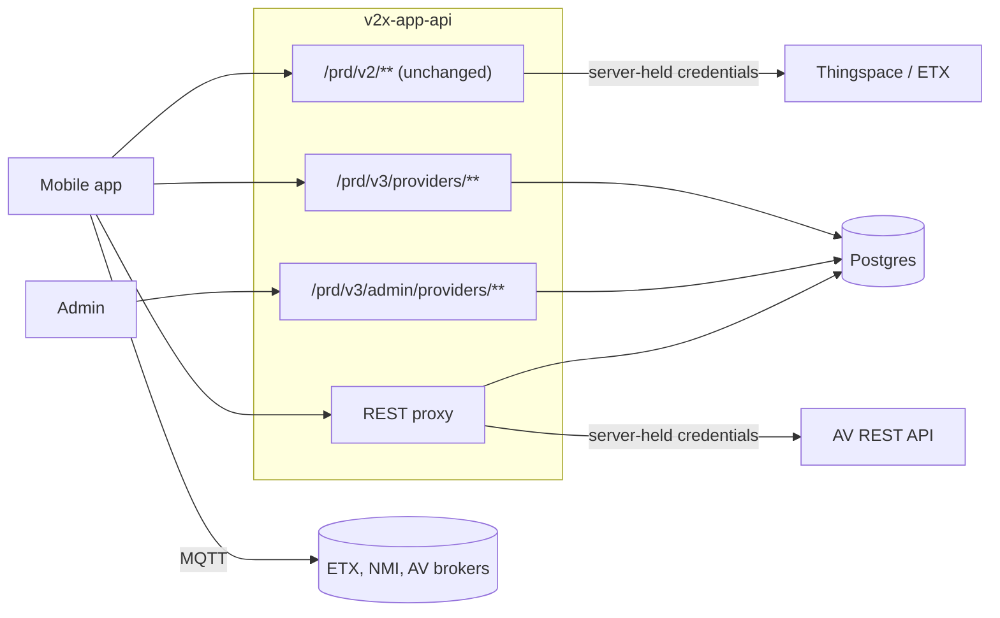

# Design: Runtime MQTT Provider Configuration (AV, ETX, NMI)

| | |
|---|---|
| **Status** | Draft for peer review |
| **Component** | v2x-app-api. Mobile app changes are tracked separately. |
| **Review** | Comment inline on the PR. |

## 1. Background

The mobile app works with three MQTT brokers today, and it learns about each one in a different way:

- **ETX/Thingspace** is configured through v2x-app-api:
  - `POST /prd/v2/connection` returns the broker URL.
  - `GET /prd/v2/acl-rules` returns the topic permissions.
- **NMI** (National Mobility Interchange) is **hardcoded in the app**: host, port, topic layout and payload format. Changing any of these requires a new app build.
- **Ettifos OBU** (the broker embedded in an Ettifos on-board unit) is **configured in the app's settings**: the user enters the address of their OBU, typically an IP.

**AV** is a new broker that must be added. It differs from the existing ones:

- MQTT connections need a username and password.
- The app needs TIM data from AV's REST API, which requires credentials that must not be placed on devices.
- Topics include an agency level. There is more than one agency (`DDOT`, `Raven`). The agencies the app publishes to and subscribes to must each be changeable without an app release.

| | ETX | NMI (existing, hardcoded) | AV (new) |
|---|---|---|---|
| Connection | From `POST /prd/v2/connection` | `mqtt.us.mobilityinterchange.com`, `tcp:1883` | `v2x.aitoms.net`, `tcp:1883` |
| MQTT auth | ETX certificate | Anonymous | Username and password |
| Topics | ETX ACL rules | `v1/g32/{geohash path}/{messageId}` | `{MSG}/unsigned/J2735/{agency}/{geohash path}`, and `TIM/unsigned/J2735/{geohash path}` for TIM |
| Payload | Geo-routed proto, unsigned UPER | IEEE 1609.2 signed UPER | Unsigned UPER |
| REST API | Proxied by v2x-app-api (Thingspace) | None | TIM REST API, to be **proxied by v2x-app-api** |

**Providers served by v2x-app-api: ETX/Thingspace, NMI and AV.**

**The Ettifos OBU connection stays configured only in the mobile app.** Each phone may connect to a different OBU, so its address belongs to the device, not the API. If we later want the OBU's shared settings managed centrally, it can become a provider with a `DEVICE` connection source:
- The shared settings would come from the API: port, protocol, topics and payload format.
- The host would still come from the app's settings.

This is a possible future addition and is not included in this design.

## 2. Goals

1. v2x-app-api becomes the single runtime source of the app's MQTT providers: how to connect, which topics are allowed, and which MQTT credentials to use.
2. AV is added. NMI's hardcoded settings move to the API, and ETX is described as a provider.
3. Adding or changing a provider, a topic or an agency is a configuration change, not an app release.
4. Credentials can differ by user role, in the same way ETX registration uses a different vendor ID for depositors.
5. AV REST calls go through a v2x-app-api proxy, so REST secrets stay on the server.
6. Credentials are encrypted at rest, masked in admin views unless an admin explicitly reveals them, and never written to logs.
7. Every existing v2 endpoint keeps its current behavior.

## 3. Overview



**What the provider API gives the mobile app:**

| Capability | Endpoint | Used by |
|---|---|---|
| Provider list: connection settings and payload format | `GET /prd/v3/providers` | ETX, NMI, AV |
| ACL rules: the topics the app may publish and subscribe to | `GET /prd/v3/providers/{key}/acl-rules` | ETX, NMI, AV |
| MQTT credentials for the caller's role | `GET /prd/v3/providers/{key}/credentials` | AV. NMI is anonymous, and ETX uses its certificate. |
| REST proxy to the provider's REST API | `/prd/v3/providers/{key}/rest/{endpoint}` | AV (TIM) |

**Interactions outside this API:**
- ETX registration and certificate-based connection keep using the existing v2 endpoints (`/prd/v2/registration` and `/prd/v2/connection`).
- There are no other provider-specific interactions.
- MQTT messages never pass through v2x-app-api. The app connects to each provider's broker directly.

**At startup, the app:**
1. Lists the providers.
2. Fetches each provider's ACL rules and, where needed, its MQTT credentials.
3. Connects to each broker.

## 4. Topic templates

**Each provider defines its own topic structure on its own broker.** v2x-app-api does not run or proxy an MQTT broker. Topic templates are how the API describes each provider's real topics to the app:
- `@` and `{name}` are notation used only in API responses.
- They are replaced before anything is sent to a broker: the API substitutes `{name}`, and the app expands `@`.
- Brokers only ever see the provider's real topic names.

For example, the template `MAP/unsigned/J2735/{subscribeAgency}/@` describes AV's real topics, such as `MAP/unsigned/J2735/DDOT/d/p/3/w/j/z/b`.

Templates use the existing **ETX ACL syntax**, so the app's current ACL handling still applies. Two tokens are added:

| Token | Meaning | Expanded by |
|---|---|---|
| `\|`, `+`, `*`, `#` | Unchanged from ETX: alternatives within a level, and wildcards. | App or broker |
| **`@`** *(new)* | Geohash path. It fills a whole topic level and expands into one level per geohash character. | App |
| **`{name}`** *(new)* | Topic variable, such as `{subscribeAgency}`. It fills a whole level and is replaced by its configured value or values. | API, before responding |

### 4.1 Topic variables and multiple agencies

- A variable holds **one or more values**. When there are several, the API joins them with `|`, so the app expands them as ordinary ETX alternatives.
- **AV publish and subscribe agencies are configured separately:**
  - Publish templates use `{publishAgency}`.
  - Subscribe templates use `{subscribeAgency}`.

  By default the app publishes only to DDOT and subscribes to both DDOT and Raven.

| | Publish agencies | Subscribe agencies |
|---|---|---|
| Variable | `{publishAgency}` | `{subscribeAgency}` |
| Environment default | `AV_PUBLISH_AGENCIES=DDOT` | `AV_SUBSCRIBE_AGENCIES=DDOT,Raven` |
| Admin override (body is a list of agencies, e.g. `["DDOT", "Raven"]`) | `PUT /prd/v3/admin/providers/av/topic-variables/publishAgency` | `PUT /prd/v3/admin/providers/av/topic-variables/subscribeAgency` |
| Example template | `PSM/unsigned/J2735/{publishAgency}/@` | `MAP/unsigned/J2735/{subscribeAgency}/@` |
| Returned to the app (defaults) | `PSM/unsigned/J2735/DDOT/@` | `MAP/unsigned/J2735/DDOT\|Raven/@` |

- **Where values come from:**
  - An admin override set through the API takes effect immediately, with no redeploy.
  - Otherwise the environment default applies.
  - Deleting an override reverts to the environment default.
- The app publishes each message under every agency in the publish list, and subscribes to every agency in the subscribe list.
- **Allowed values:** each value must be a literal topic level, with no separators, wildcards, `|`, braces or `@`. Values are case-sensitive and must match AV's topics exactly.
- **Consistency is enforced on writes:**
  - A rule can't reference a variable that has no values.
  - A variable's last value can't be removed while a rule still uses it.
  - A value change that would push a rule past its subscribe limit is rejected.

  Together these mean the app never receives an unresolved topic.

### 4.2 Geohash expansion in the app

Each rule includes the settings the app needs to expand `@`:
- number of levels (7)
- publish and subscribe precision (7)
- subscribe grid radius (1, which gives a 3×3 grid)

A single `@` expands to as many levels as the rule specifies. A broker that uses a different geohash depth or precision therefore only needs different rule settings in the API, with no app change and no change to the template syntax.

- **Publish:**
  - Take the geohash of the event location and put one character in each level.
  - A message whose extent spans several cells is published once per cell, with the same message ID.
- **Subscribe:**
  - Subscribe to the device's current cell plus its 8 neighbours.
  - When the device enters a new cell, resubscribe to match the new grid. This is the same approach the app uses for ETX today.

Example for centre cell `dp3wjzb`: `TIM/unsigned/J2735/@` becomes `TIM/unsigned/J2735/d/p/3/w/j/z/b`. The app subscribes to that topic and the same topic for each of the 8 neighbouring cells.

### 4.3 Subscription limit and validation

`subscribeLimit` counts the subscriptions the app actually opens. For each template, that's (number of `|` alternatives) × 9 cells, summed over all subscribe templates.

| Rule | Subscribe topics | Count |
|---|---|---|
| NMI | `v1/g32/@/31\|19\|18\|41` | 4 × 9 = 36 |
| AV, 2 agencies | PSM, BSM, SDSM, SPAT, MAP × `DDOT\|Raven`, plus TIM | 11 × 9 = 99 |

When a rule is saved, it is rejected with a 400 if any of these fail:

- `@` appears at most once and occupies a whole level.
- `#` appears only as the last level.
- Publish topics contain no wildcards.
- Precision and grid radius are within their bounds.
- The expanded count fits within `subscribeLimit`.

## 5. API

### 5.1 Versioning

- **`/prd/v2/**` is unchanged.** Current app builds are unaffected.
- **New endpoints live under `/prd/v3/**`** and are served by the same application.
- **ETX reuses the v2 code.** The v3 ETX ACL endpoint calls the same logic as `/prd/v2/acl-rules`, and a test checks that both return the same result.
- **Existing security and request logging already cover `/prd/v3/**`.**

### 5.2 Mobile endpoints

These are open to `USER`, `DEPOSITOR` and `ADMIN`.

| Method | Path | Returns |
|---|---|---|
| GET | `/prd/v3/providers` | Enabled providers: connection info, payload format, and the proxy endpoints available to the caller. No secrets and no upstream URLs. |
| GET | `/prd/v3/providers/{key}/acl-rules` | ACL rules in the ETX format plus the geohash settings, with variables resolved. |
| GET | `/prd/v3/providers/{key}/credentials` | MQTT credentials for the caller's role. Sent with `Cache-Control: no-store`. Returns 404 if the provider has none, as with NMI. |
| *varies* | `/prd/v3/providers/{key}/rest/{endpoint}/…` | REST proxy ([section 6](#6-rest-proxy)). |

<details>
<summary>Example: <code>GET /prd/v3/providers</code></summary>

Null fields are left out. `credentialsPath` appears only when MQTT credentials exist for the caller's role. `rest.endpoints` lists only the proxy endpoints the caller may use. The `tim` endpoint is illustrative: the real endpoints will come from AV's OpenAPI spec.

```json
[
    {
        "key": "etx",
        "type": "ETX",
        "displayName": "ETX",
        "enabled": true,
        "priority": 0,
        "mqtt": { "connectionSource": "ETX_CONNECTION", "authType": "ETX_CERT" },
        "payloadFormat": "GEO_ROUTED_PROTO_UNSIGNED_UPER",
        "aclRulesPath": "/prd/v3/providers/etx/acl-rules"
    },
    {
        "key": "nmi",
        "type": "NMI",
        "displayName": "OmniTrust National Mobility Interchange",
        "enabled": true,
        "priority": 10,
        "mqtt": { "connectionSource": "STATIC", "host": "mqtt.us.mobilityinterchange.com", "protocol": "tcp", "port": 1883, "tls": false },
        "payloadFormat": "IEEE1609_2_SIGNED_UPER",
        "aclRulesPath": "/prd/v3/providers/nmi/acl-rules"
    },
    {
        "key": "av",
        "type": "AV",
        "displayName": "AV",
        "enabled": true,
        "priority": 20,
        "mqtt": { "connectionSource": "STATIC", "host": "v2x.aitoms.net", "protocol": "tcp", "port": 1883, "tls": false, "authType": "USERNAME_PASSWORD" },
        "rest": {
            "endpoints": {
                "tim": { "path": "/prd/v3/providers/av/rest/tim", "methods": ["GET"] }
            }
        },
        "payloadFormat": "UNSIGNED_UPER",
        "aclRulesPath": "/prd/v3/providers/av/acl-rules",
        "credentialsPath": "/prd/v3/providers/av/credentials"
    }
]
```
</details>

<details>
<summary>Example: <code>GET /prd/v3/providers/nmi/acl-rules</code></summary>

```json
[
    {
        "name": "nmi.mobile.default",
        "subscribeLimit": 36,
        "publishRateLimit": 10,
        "geohash": { "symbol": "@", "levels": 7, "publishPrecision": 7, "subscribePrecision": 7, "subscribeGridRadius": 1 },
        "publish": [
            "v1/g32/@/20|32"
        ],
        "subscribe": [
            "v1/g32/@/31|19|18|41"
        ]
    }
]
```
</details>

<details>
<summary>Example: <code>GET /prd/v3/providers/av/acl-rules</code></summary>

```json
[
    {
        "name": "av.mobile.default",
        "subscribeLimit": 99,
        "publishRateLimit": 10,
        "geohash": { "symbol": "@", "levels": 7, "publishPrecision": 7, "subscribePrecision": 7, "subscribeGridRadius": 1 },
        "publish": [
            "PSM/unsigned/J2735/DDOT/@",
            "BSM/unsigned/J2735/DDOT/@"
        ],
        "subscribe": [
            "PSM/unsigned/J2735/DDOT|Raven/@",
            "BSM/unsigned/J2735/DDOT|Raven/@",
            "SDSM/unsigned/J2735/DDOT|Raven/@",
            "SPAT/unsigned/J2735/DDOT|Raven/@",
            "MAP/unsigned/J2735/DDOT|Raven/@",
            "TIM/unsigned/J2735/@"
        ]
    }
]
```
</details>

<details>
<summary>Example: <code>GET /prd/v3/providers/av/credentials</code></summary>

`credentialRole` shows which role's credential set was selected. This response contains MQTT credentials only. REST credentials never leave the server.

```json
{
    "provider": "av",
    "credentialRole": "DEPOSITOR",
    "mqtt": { "username": "…", "password": "…" },
    "updatedAt": "2026-11-10T12:00:00Z"
}
```
</details>

### 5.3 Admin endpoints (`ADMIN` only)

These follow the conventions of the existing admin endpoints: POST upserts a record, and DELETE soft-deletes it.

| Resource | Path under `/prd/v3/admin/providers` | Operations |
|---|---|---|
| Providers | `/`, `/{key}` | List, get, upsert, delete, enable/disable |
| ACL rules | `/{key}/acl-rules[/{name}]` | List, upsert (validated), delete |
| Topic variables | `/{key}/topic-variables[/{name}]` | List effective values, set a value list, revert to the default |
| REST endpoints | `/{key}/rest-endpoints[/{name}]` | List, upsert, delete the proxy allowlist |
| Credentials | `/{key}/credentials[/{role}]` | Masked list; read plaintext for one role (`/{key}/credentials/{role}?reveal=true`); set/rotate and delete, per role |

## 6. REST proxy

### 6.1 How it works

The app calls `/prd/v3/providers/{key}/rest/{endpoint}/…`. v2x-app-api forwards the request to the provider's configured REST endpoint and adds the upstream credentials for the caller's role ([section 7](#7-credentials)). It then returns the response to the app.

- **Allowlisted endpoints only.**
  - The upstream base URL and the endpoint paths come from admin configuration, never from the request.
  - Each endpoint has allowed HTTP methods and can be limited to certain roles.
  - Path traversal is rejected.
- **The caller's token is never forwarded.**
  - Only a small allowlist of request and response headers is passed through.
  - Upstream auth supports Basic, API key, Bearer and OAuth2 client credentials, with OAuth2 tokens cached.
- **Errors are mapped to make the cause clear.** If the upstream rejects our credentials, the app gets a 502, because this is a server problem rather than the caller's. An upstream timeout returns a 504.
- **Endpoints come from AV's OpenAPI spec.** AV will provide the spec. The endpoints, methods and auth type will be configured from it, and none are seeded until it arrives.

### 6.2 Same approach as the existing Thingspace proxy

v2x-app-api already sits between the app and Thingspace. The AV proxy follows the same model.

| | Thingspace (existing) | AV (proposed) |
|---|---|---|
| Upstream credentials | OAuth2 client key/secret and M2M login, held by the API | AV REST credentials, held by the API (encrypted in the database) |
| What the app holds | Its Keycloak token only | Its Keycloak token only |
| Token handling | API obtains and caches access and session tokens | API adds Basic/API-key/Bearer auth, or obtains and caches OAuth2 tokens |
| Role-specific behavior | Depositors use a different vendor ID | Credential set chosen by role |
| Server-side controls | Registration limits, ACL subscribe filter, response mapping | Endpoint allowlist, method and role scoping. Mapping or filtering can be added later. |

**Benefit: AV changes are absorbed in the API instead of in app builds.** The app depends only on the stable v2x-app-api path. Each of these is a configuration change, or at most an API deployment, with no new app build:

- Rotating or replacing AV credentials, or giving a role its own credentials.
- Changing AV's base URL, its auth scheme, or the upstream path of an endpoint.
- Adding, removing or restricting endpoints.
- Adapting to a new AV API version by remapping, or by transforming requests and responses in the API.
- Adding rate limiting, caching or response filtering later. The ACL subscribe filter was added for ETX the same way.

## 7. Credentials

### 7.1 Credential sets by role

- A provider can have one credential set per role: `USER`, `DEPOSITOR` or `ADMIN`.
- A set can contain MQTT credentials (returned to the app), REST credentials (used only by the proxy), or both.
- **Selection order:** `ADMIN → DEPOSITOR → USER`. The caller gets the first set that exists for a role they hold, working down the chain. For example, an admin with no admin set gets the depositor set.
- MQTT and REST credentials are selected independently. This lets a role have its own MQTT login while sharing a REST credential.
- If no set applies, the credentials endpoint returns 404 and authenticated proxy calls fail with a 502. Both cases are logged.

### 7.2 Security

- **Encrypted at rest** with AES-256-GCM, using a random IV per value and a key version prefix. The key comes from the environment (`PROVIDER_CREDENTIALS_ENCRYPTION_KEY`) and is never committed.
- **If the key is missing or wrong,** the application still starts. The credential and proxy features return 503, and the rest of the API is unaffected.
- **Key rotation** is a manual procedure, used when the key may have been exposed, someone with access to it leaves, or policy requires it:
  1. Read the current credentials through the admin API.
  2. Change the key and bump the version, then redeploy.
  3. Re-enter the credentials.

  The version prefix shows which stored values were encrypted under an old key.
- **Admins can read secrets.**
  - By default, admin views mask values.
  - An admin can request one role's credentials in plaintext with `?reveal=true`.
  - Reveal responses are sent with `no-store`.
  - Each reveal is audit-logged with the admin, provider, role and time, but never the value.
- **Only MQTT credentials ever reach devices.** They are served over HTTPS from a dedicated endpoint with `no-store`. REST credentials never leave the server.
- **No secrets in logs.**
  - The existing error logging saves the bodies of failed POST/PUT requests to the database. Admin credential requests must be excluded from this, and a test must cover it.
  - Credential responses and outgoing auth headers are never logged.
- **No secrets in SQL, sample env files or docs.**
- **Remaining risk:** MQTT credentials are shared within a role, so a leaked credential works for anyone with that role. Role-specific sets limit how far a leak spreads, and rotation plus AV's broker ACLs mitigate it further.

## 8. Data model

The new tables are added by migration `010_add_mqtt_providers.sql`, following the style of the existing migrations (idempotent, with audit columns and triggers). There are no changes to existing tables.

| Table | Purpose |
|---|---|
| `mqtt_providers` | Key, type, priority, enabled flag, MQTT connection, payload format, REST base URL and auth type |
| `mqtt_provider_rest_endpoints` | Proxy allowlist: name, upstream path, allowed methods, roles |
| `mqtt_provider_acl_rules` and topic child tables | Limits, geohash settings, role scoping, publish and subscribe templates |
| `mqtt_provider_topic_variables` | Admin overrides: an ordered list of values per variable (for example `subscribeAgency` → `DDOT`, `Raven`) |
| `mqtt_provider_credentials` | One row per (provider, role), with encrypted secrets |
| `j2735_message_ids` | Reference mapping of message types to the IDs used in NMI topics (BSM 20, PSM 32, TIM 31, SPAT 19, MAP 18, SDSM 41) |

**Seed data** is written so that re-running the migration never overwrites admin changes:

- **etx:** uses the existing connection endpoint. Its ACLs still come from ETX.
- **nmi:** the production host, plus its default rule.
- **av:** its default rule, seeded **disabled**. An admin enables it after configuring REST endpoints from AV's spec and entering credentials.
- No secrets are seeded.

## 9. Rollout (Leidos VM)

1. Back up the database.
2. Add the encryption key and the default publish and subscribe agency lists to the environment.
3. Deploy the image and apply migration 010.
4. As an admin:
   1. Configure the AV REST endpoints.
   2. Enter credentials for each role.
   3. Enable AV.
5. Verify:
   - The provider list is correct.
   - The ACL rules reflect the configured publish and subscribe agencies.
   - `USER` and `DEPOSITOR` tokens each receive their own credential set.
   - The proxy returns AV data.
   - Only ciphertext is stored in the database.
   - The v2 endpoints are unchanged.
   - Broker smoke tests pass.

**Rollback:** disabling AV takes effect immediately, with no redeploy. Redeploying the previous image is also safe, because older code ignores the new tables.

## 10. Testing

- **Unit tests:**
  - Topic validation and subscription counts.
  - Resolution of multi-value variables.
  - Encryption, including round trip, tamper detection and wrong or missing key.
  - Credential selection by role.
  - Proxy behavior: allowlist, method and role checks, header handling, upstream auth, and error mapping, tested against a mock upstream.
  - Credentials are masked by default in admin views.
  - The admin-only reveal returns plaintext and writes an audit log entry.
  - Credentials are kept out of the error log.
  - v2 and v3 ETX parity.
- **Migration test:** idempotency and constraints, in the style of the existing migration tests.
- **Local integration testing:**
  - Admin and mobile flows with each role.
  - The proxy, against AV or a stub built from its OpenAPI spec.
  - v2 regression.
  - Broker smoke tests.
  - Results are recorded on the ticket.

## 11. Alternatives considered

| Alternative | Reason not chosen |
|---|---|
| Config in env or yml only | Every change would need a redeploy, and credentials couldn't be managed at runtime. Env remains for deployment defaults. |
| External secrets manager | None exists in the current deployments. The encryption code is isolated, so it can be swapped in later. |
| App calls AV REST directly | Puts a long-lived REST secret on every device, and ties the app to AV's API. Rejected in review. |
| Generic open proxy | SSRF risk. Only admin-configured endpoints are reachable. |
| One agency list shared by publish and subscribe | Can't receive from an agency without also publishing to it. Separate lists cost one extra variable. |
| One agency per deployment | Doesn't support DDOT and Raven together. Multi-value variables reuse the existing `\|` expansion. |
| One `@` per geohash level (`@/@/@/@/@/@/@`) | The rule's `levels` and precision settings already control the depth. Repeating the token would duplicate that setting and give the parser more to validate. |
| Serve the Ettifos OBU address from the API | Each device may pair with a different OBU, so the address is device-specific. Shared OBU settings could be added later with a `DEVICE` connection source. |
| Structured topic fields instead of templates | Would need a new parser in the app. Templates reuse the existing ACL handling. |

## 12. Implementation plan

Implementation starts after this design is approved. It is delivered as a series of small PRs, each with its own tests and docs, and none of them changes v2 behavior:

1. Credential encryption.
2. Topic template validation and variable resolution, with multi-value support.
3. Database migration 010.
4. Provider domain and admin API (providers, ACL rules, topic variables, REST endpoints).
5. Role-based credentials: admin and mobile endpoints, and redaction from the error log.
6. Mobile v3 provider and ACL endpoints, with ETX delegation.
7. REST proxy.
8. OpenAPI and README updates, plus an AV enablement runbook.

PRs 1–3 are independent of each other. PR 4 depends on 2 and 3, PR 5 on 1 and 4, PR 6 on 4, and PR 7 on 5.
