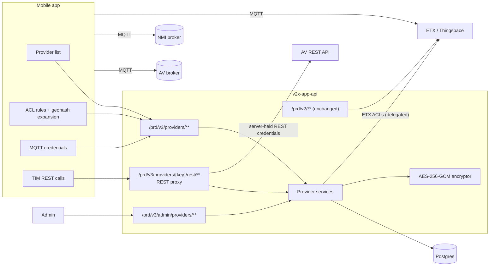
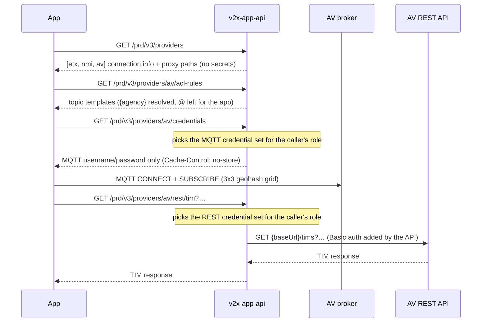
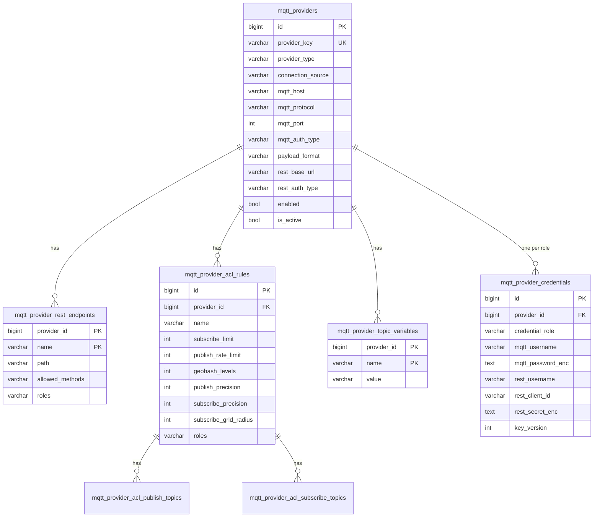

# Design: Runtime MQTT Provider Configuration (AV, ETX, NMI)

| | |
|---|---|
| **Status** | Draft, open for peer review (revision 2, includes the first round of review decisions) |
| **Component** | v2x-app-api |
| **Scope** | API only. Mobile app changes are tracked separately. |
| **Reviewers** | Please comment inline on the PR. Decisions so far are in [section 14](#14-review-decisions) and the remaining questions are in [section 15](#15-open-questions). |

## 1. Background

Today the mobile app connects to one MQTT broker, ETX/Thingspace:

- The broker URL comes from `POST /prd/v2/connection` (`ConnectionResponse.MqttURL`).
- Topic permissions come from `GET /prd/v2/acl-rules`. This proxies ETX `/api/v1/device-roles/vendor` and can be narrowed by `AclRulesFilter`.
- Everything else (topic grammar, payload formats, message types) is hardcoded, either in the app or in `AclRulesFilter` constants.

Two more brokers need to be supported:

| | **AV** (primary target) | **NMI** (National Mobility Interchange) |
|---|---|---|
| MQTT auth | Username and password | Anonymous |
| Endpoint | `v2x.aitoms.net`, `tcp:1883` | `mqtt.us.mobilityinterchange.com`, `tcp:1883` (production only) |
| Topic layout | `{MSG}/unsigned/J2735/{agency}/{geohash path}`, except TIM, which is `TIM/unsigned/J2735/{geohash path}` | `v1/g32/{geohash path}/{messageId}` |
| Geohash path | One character per topic level, precision 7 | One character per topic level, precision 7 |
| Payload | Unsigned UPER | IEEE 1609.2 signed UPER |
| REST API | TIM REST API with credentials, **proxied by v2x-app-api** | None |

- AV requires MQTT credentials, which can't be compiled into the app and must be delivered at runtime.
- AV's REST credentials must **never reach devices**. v2x-app-api calls the AV REST API for the app instead.
- AV topics contain an agency level (for example `DDOT`) that must be changeable without an app release.

## 2. Goals and non-goals

**Goals**

1. Make v2x-app-api the runtime source of truth for the MQTT providers the app should use:
   - how to connect to each one
   - which topics the app may publish and subscribe to
   - which MQTT credentials it uses
2. Fully support AV, and describe ETX and NMI as providers too.
3. Make adding or changing a provider a configuration change, not an app release.
4. Let provider-specific topic values, such as the AV agency, be configured without code changes.
5. Support **different credentials for different user roles**, in the same way ETX registration gives depositor users a different vendor ID.
6. Keep REST API secrets on the server. The app reaches provider REST APIs only through a v2x-app-api proxy.
7. Encrypt credentials at rest, and never show them in admin views or logs.
8. Keep every existing v2 endpoint behaving exactly as it does today.

**Non-goals**

- Mobile app changes to use the new API.
- Obtaining the AV credentials from the AV provider.
- Deprecating or moving existing v2 endpoints.
- Per-user or per-device broker credentials. Credentials vary by **role**, not by user ([section 13](#13-alternatives-considered)).
- Proxying MQTT broker traffic. The app still connects to each broker directly.
- Listing non-production broker environments. Only production hosts are listed ([section 14](#14-review-decisions)).

## 3. Overview



App startup sequence (the app changes themselves are not part of this ticket):



## 4. Provider model

A **provider** is one MQTT broker that the app can use, plus an optional REST API.

| Field | Description |
|---|---|
| `key` | Stable lowercase identifier (`etx`, `nmi`, `av`). Used in URLs. |
| `type` | `ETX`, `NMI`, `AV` or `GENERIC`. Tells the app which provider-specific behaviour applies, if any. |
| `displayName`, `priority`, `enabled` | Presentation, ordering, and an on/off switch. |
| `mqtt.connectionSource` | `STATIC`: use the host, port and protocol stored here. `ETX_CONNECTION`: keep using `POST /prd/v2/connection`, which handles certificate provisioning. |
| `mqtt.host`, `protocol`, `port`, `tls` | Broker endpoint. `protocol` is one of `tcp`, `ssl`, `ws` or `wss`. Always the provider's **production** endpoint. |
| `mqtt.authType` | Left out when the broker is anonymous. Otherwise `USERNAME_PASSWORD` or `ETX_CERT`. |
| `payloadFormat` | `GEO_ROUTED_PROTO_UNSIGNED_UPER` (ETX), `IEEE1609_2_SIGNED_UPER` (NMI) or `UNSIGNED_UPER` (AV). |
| `rest` (server-side only) | Upstream `baseUrl`, `authType` (`NONE`, `BASIC`, `API_KEY`, `BEARER` or `OAUTH2_CLIENT_CREDENTIALS`) and named endpoints (for example `tim` → `/tims`), each with allowed methods and optional role scoping. **The app only sees the proxy paths**, never the upstream URL or the credentials. |

The REST auth model is generic so it can handle whatever AV ends up requiring. Today only AV has a REST API.

## 5. Topic templates

### 5.1 Syntax

ACL topics stay in **ETX ACL syntax**, so the app's existing ACL parsing keeps working. Two tokens are added.

| Token | Meaning | Expanded by |
|---|---|---|
| `\|` | Alternatives within one level. `20\|32` gives one topic per alternative. Unchanged from ETX. | App |
| `+`, `*` | Single-level wildcard. `*` is the ETX form and is treated the same as `+`. | Broker |
| `#` | Multi-level wildcard. Allowed only as the last level. | Broker |
| **`@`** *(new)* | **Geohash path.** Occupies a whole level and expands into the geohash characters, separated by `/`. | App |
| **`{name}`** *(new)* | **Topic variable.** Occupies a whole level and is replaced by a configured value, for example `{agency}` → `DDOT`. | API, before the response is sent |

The app never sees `{name}` placeholders, only `@`.

### 5.2 Topic variables (`{agency}`)

- **Value precedence** (highest first):
  1. A per-provider value set through the admin API (`mqtt_provider_topic_variables`).
  2. The deployment default from configuration, for example `mqtt.topic-variables.av.agency=${AV_TOPIC_AGENCY:DDOT}`.
- **Allowed values.** A value must be a single literal topic level. It can't be empty, can't have leading or trailing whitespace, and can't contain `/ + # * | { } @`. This is enforced in the API and by a DB `CHECK` constraint.
- **Missing values** are a server configuration error.
  - The admin API rejects any rule save that would leave a variable unresolved.
  - The mobile endpoint fails closed: it logs the error and returns an error response rather than an unresolved topic ([Q1](#15-open-questions)).
- **Seeded AV topics:**
  - `PSM|BSM|SDSM|SPAT|MAP` use `{MSG}/unsigned/J2735/{agency}/@`.
  - `TIM` uses `TIM/unsigned/J2735/@` (no agency level).
  - Because TIM has a different shape, AV topics are listed one per message type instead of being combined with `|` in the first level.

### 5.3 Geohash expansion in the app

Each rule includes a `geohash` block:

```json
{ "symbol": "@", "levels": 7, "publishPrecision": 7, "subscribePrecision": 7, "subscribeGridRadius": 1 }
```

- **Publish:**
  - Compute the geohash of the event location at `publishPrecision` and substitute it for `@`, one character per level.
  - If a message's extent covers more than one cell, publish it once per cell with the same message ID each time (NMI's rule).
- **Subscribe** (mirrors what the app does for ETX today):
  1. Take the device's geohash at `subscribePrecision`.
  2. Add the neighbouring cells out to `subscribeGridRadius` rings. Radius 1 gives a 3×3 grid of 9 cells.
  3. Expand each cell into every subscribe template.
  4. When the device enters a new cell, unsubscribe from cells that left the grid and subscribe to the new ones.
- **Padding.** If `subscribePrecision < levels`, fill the remaining levels with `+`. With the defaults (7 = 7) there is no padding.

Example, with centre cell `dp3wjzb`:

| Template | Expanded centre-cell topic |
|---|---|
| NMI `v1/g32/@/31` | `v1/g32/d/p/3/w/j/z/b/31` |
| AV `MAP/unsigned/J2735/{agency}/@` (agency `DDOT`) | `MAP/unsigned/J2735/DDOT/d/p/3/w/j/z/b` |
| AV `TIM/unsigned/J2735/@` | `TIM/unsigned/J2735/d/p/3/w/j/z/b` |

The app subscribes to the same topic for each of the 8 neighbouring cells as well.

### 5.4 Subscription limit

`subscribeLimit` is the number of MQTT subscriptions the app actually opens:

```
per template: (product of | alternatives) × ((2r + 1)² if it contains @, else 1)
total = sum over all subscribe templates
```

| Seed rule | Subscribe templates | Count |
|---|---|---|
| `nmi.mobile.default` | `v1/g32/@/31\|19\|18\|41` | 4 × 9 = **36** |
| `av.mobile.default` | 6 topics, each containing `@` | 6 × 9 = **54** |

### 5.5 Validation (checked when a rule is saved)

- `@` appears at most once per topic and occupies a whole level. `{name}` placeholders also occupy whole levels.
- `#` appears only as the last level.
- Publish topics contain no wildcards. `|` alternatives are allowed.
- `publishPrecision` and `subscribePrecision` are each between 1 and `levels`, and `levels` is at most 12.
- `subscribeGridRadius` is between 0 and 2.
- `subscribeLimit` is at least the expanded count from [section 5.4](#54-subscription-limit).
- Every `{name}` used has a value ([section 5.2](#52-topic-variables-agency)).

Errors return HTTP 400 through `GlobalExceptionHandler`.

### 5.6 J2735 message IDs

NMI topics end with the integer `DSRCmsgID`. A reference table, `j2735_message_ids`, holds the mapping so admin tooling and docs don't need hardcoded numbers:

| BSM | PSM | TIM | SPAT | MAP | SDSM |
|---|---|---|---|---|---|
| 20 | 32 | 31 | 19 | 18 | 41 |

This table is separate from `message_types`, which is the foreign-key domain for deposits.

## 6. API

### 6.1 Versioning

- **Nothing under `/prd/v2/**` changes**: not the paths, payloads or behaviour. Current app builds are unaffected.
- **All new endpoints are under `/prd/v3/**`.** They are served by the same application, in a new `usdot.v2x.app.api.v3.*` package, with a shared `ApiPaths` constants class (`V2`, `V3`).
- **v3 reuses the v2 services.** `GET /prd/v3/providers/etx/acl-rules` calls the same `RegistrationApi.getDeviceRoles()` and `AclRulesFilter` as `GET /prd/v2/acl-rules`, so the ETX logic has one source of truth. A test asserts the two return identical bodies.
- **No infrastructure changes are needed.** `AccessController` (`/**`), `RequestBodyCaptureFilter` and `ErrorLoggingService` (both keyed on `/prd/`) already cover `/prd/v3/**`.
- **OpenAPI** stays as one springdoc document, so the `generateOpenApiDocs` output (`docs/v2x-app-api-openapi.json`) keeps building. New controllers are tagged `Providers (v3)` and `Provider Admin (v3)`.

### 6.2 Mobile endpoints

These allow `ADMIN`, `DEPOSITOR` and `USER`, the same as `/prd/v2/acl-rules`.

| Method | Path | Returns |
|---|---|---|
| GET | `/prd/v3/providers` | Enabled providers ordered by `priority`: connection info and the REST proxy paths the caller may use. **No secrets and no upstream REST URLs.** |
| GET | `/prd/v3/providers/{key}/acl-rules` | ACL rules in the ETX shape plus `geohash`, filtered to the caller's roles, with variables resolved. |
| GET | `/prd/v3/providers/{key}/credentials` | **MQTT credentials only**, using the set for the caller's role ([section 8.1](#81-role-based-credential-sets)). Sent with `Cache-Control: no-store`. Returns 404 when the provider has no MQTT credentials, as with NMI. |
| *per endpoint* | `/prd/v3/providers/{key}/rest/{endpoint}[/…]` | **REST proxy** to the provider's named upstream endpoint, authenticated with the server-held REST credentials for the caller's role ([section 7](#7-rest-proxy)). |

<details>
<summary><code>GET /prd/v3/providers</code> example</summary>

Null fields are omitted.

```json
[
    {
        "key": "etx",
        "type": "ETX",
        "displayName": "ETX",
        "enabled": true,
        "priority": 0,
        "mqtt": { "connectionSource": "ETX_CONNECTION", "authType": "ETX_CERT" },
        "payloadFormat": "GEO_ROUTED_PROTO_UNSIGNED_UPER",
        "aclRulesPath": "/prd/v3/providers/etx/acl-rules"
    },
    {
        "key": "nmi",
        "type": "NMI",
        "displayName": "OmniTrust National Mobility Interchange",
        "enabled": true,
        "priority": 10,
        "mqtt": { "connectionSource": "STATIC", "host": "mqtt.us.mobilityinterchange.com", "protocol": "tcp", "port": 1883, "tls": false },
        "payloadFormat": "IEEE1609_2_SIGNED_UPER",
        "aclRulesPath": "/prd/v3/providers/nmi/acl-rules"
    },
    {
        "key": "av",
        "type": "AV",
        "displayName": "AV",
        "enabled": true,
        "priority": 20,
        "mqtt": { "connectionSource": "STATIC", "host": "v2x.aitoms.net", "protocol": "tcp", "port": 1883, "tls": false, "authType": "USERNAME_PASSWORD" },
        "rest": {
            "endpoints": {
                "tim": { "path": "/prd/v3/providers/av/rest/tim", "methods": ["GET"] }
            }
        },
        "payloadFormat": "UNSIGNED_UPER",
        "aclRulesPath": "/prd/v3/providers/av/acl-rules",
        "credentialsPath": "/prd/v3/providers/av/credentials"
    }
]
```

- `credentialsPath` is included only when a credential set with MQTT credentials resolves for the caller's role.
- `rest.endpoints` lists only the endpoints the caller's role may use.
</details>

<details>
<summary><code>GET /prd/v3/providers/av/acl-rules</code> example (agency = DDOT)</summary>

```json
[
    {
        "name": "av.mobile.default",
        "subscribeLimit": 54,
        "publishRateLimit": 10,
        "geohash": { "symbol": "@", "levels": 7, "publishPrecision": 7, "subscribePrecision": 7, "subscribeGridRadius": 1 },
        "publish": [
            "PSM/unsigned/J2735/DDOT/@",
            "BSM/unsigned/J2735/DDOT/@"
        ],
        "subscribe": [
            "PSM/unsigned/J2735/DDOT/@",
            "BSM/unsigned/J2735/DDOT/@",
            "SDSM/unsigned/J2735/DDOT/@",
            "SPAT/unsigned/J2735/DDOT/@",
            "MAP/unsigned/J2735/DDOT/@",
            "TIM/unsigned/J2735/@"
        ]
    }
]
```

The NMI rule has the same shape, with `publish: ["v1/g32/@/20|32"]`, `subscribe: ["v1/g32/@/31|19|18|41"]` and `subscribeLimit: 36`.
</details>

<details>
<summary><code>GET /prd/v3/providers/av/credentials</code> example</summary>

```json
{
    "provider": "av",
    "credentialRole": "DEPOSITOR",
    "mqtt": { "username": "…", "password": "…" },
    "updatedAt": "2026-11-10T12:00:00Z"
}
```

- `credentialRole` tells the app which set was selected (`DEFAULT`, `USER`, `DEPOSITOR` or `ADMIN`). It contains no secret.
- REST credentials are **never** included.
</details>

### 6.3 Admin endpoints (`ROLE_ADMIN` only)

These follow the `VendorLimitsRestController` conventions: POST upserts, and DELETE soft-deletes (`is_active = false`).

| Method | Path | Purpose |
|---|---|---|
| GET | `/prd/v3/admin/providers` | List all providers, including disabled ones. |
| GET | `/prd/v3/admin/providers/{key}` | Get one provider, including the upstream REST config. |
| POST | `/prd/v3/admin/providers` | Create a provider, or upsert it by `key`. |
| DELETE | `/prd/v3/admin/providers/{key}` | Soft-delete a provider. |
| GET / POST | `/prd/v3/admin/providers/{key}/rest-endpoints` | List or upsert named REST endpoints: name, upstream path, allowed methods and role scoping. |
| DELETE | `/prd/v3/admin/providers/{key}/rest-endpoints/{name}` | Remove an endpoint from the proxy allowlist. |
| GET / POST | `/prd/v3/admin/providers/{key}/acl-rules` | List rules with their role scoping, or upsert a rule by `name` (validated per [section 5.5](#55-validation-checked-when-a-rule-is-saved)). |
| DELETE | `/prd/v3/admin/providers/{key}/acl-rules/{name}` | Soft-delete a rule. |
| GET | `/prd/v3/admin/providers/{key}/topic-variables` | Effective variable values, each marked with its source (DB or configuration). |
| PUT / DELETE | `/prd/v3/admin/providers/{key}/topic-variables/{name}` | Set a DB override, or remove it and fall back to the configured default. |
| GET | `/prd/v3/admin/providers/{key}/credentials` | **Masked** view of every credential set, one per role: usernames, `hasPassword`/`hasSecret`, the last 4 characters (`••••1234`) and `updatedAt`. |
| PUT | `/prd/v3/admin/providers/{key}/credentials/{role}` | Set or rotate the credential set for `default`, `user`, `depositor` or `admin`. Write-only. |
| DELETE | `/prd/v3/admin/providers/{key}/credentials/{role}` | Remove one role's credential set. |

### 6.4 Error behaviour

| Condition | Status |
|---|---|
| Unknown or disabled provider key on a mobile endpoint | 404 |
| No MQTT credential set resolves for the caller's role | 404 |
| Invalid topic template, limit or variable value | 400 |
| Non-admin calling an admin endpoint | 403 |
| Encryption key missing, or a stored value can't be decrypted with the current key | 503 |
| ETX upstream failure (ETX provider only) | Same as `/prd/v2/acl-rules` today |
| Proxy errors | See [section 7.3](#73-request-and-response-handling) |

## 7. REST proxy

The app never holds REST API secrets. Instead, it calls v2x-app-api, which forwards the request to the provider's REST API and adds the upstream authentication itself.

### 7.1 Routing and allowlist

```
/prd/v3/providers/{key}/rest/{endpoint}[/{subpath…}][?query]
        → {rest_base_url}{endpoint.path}[/{subpath…}][?query]
```

Example: `GET /prd/v3/providers/av/rest/tim?lat=38.9&lon=-77.0` is forwarded to `GET {AV base URL}/tims?lat=38.9&lon=-77.0`.

- **Only named endpoints are reachable**, as configured in `mqtt_provider_rest_endpoints`. The base URL and endpoint paths are admin-controlled and never taken from the request, so the proxy can't be pointed at arbitrary hosts (SSRF).
- `subpath` must be plain path segments. Any `.` or `..` segment, encoded `/` or `\`, or absolute URL is rejected with 400.
- Each endpoint has **allowed methods** (default `GET`). Any other method returns 405.
- Each endpoint has optional **role scoping**, the same CSV model as ACL rules. A caller without a matching role gets 403. Example: a TIM `POST` could be limited to `DEPOSITOR`.
- The provider must be enabled, and `rest_base_url` must be `https://`, unless an explicit dev override is set.

### 7.2 Upstream authentication

- The proxy picks the **REST credential set for the caller's role**, using the same rules as MQTT ([section 8.1](#81-role-based-credential-sets)).
- `BASIC`: sends `Authorization: Basic …`.
- `API_KEY`: sends the configured header.
- `BEARER`: sends `Authorization: Bearer …`.
- `OAUTH2_CLIENT_CREDENTIALS`: fetches a token from `tokenUrl` and caches it per (provider, credential role) until shortly before it expires.
- The caller's own `Authorization` header (the Keycloak token) is **always removed** and never forwarded upstream.

### 7.3 Request and response handling

| Aspect | Behaviour |
|---|---|
| Request headers forwarded | Allowlist: `Accept`, `Accept-Language`, `Content-Type`, `If-None-Match`, `If-Modified-Since`. All others are dropped, including `Authorization`, `Cookie` and hop-by-hop headers. |
| Request body | Forwarded for methods that allow one, up to the configured size limit (default 1 MiB). Larger bodies return 413. |
| Response | Upstream status, body and an allowlisted set of headers are passed through: `Content-Type`, `Cache-Control`, `ETag`, `Last-Modified`. `Set-Cookie` and hop-by-hop headers are dropped. |
| Upstream `401`/`403` | Returned as **502**. This means the server's credentials are wrong, not the caller's. It is logged so an admin can rotate them. |
| Upstream unreachable, or timeout | 502, or 504 for a timeout. Timeouts and buffer limits come from the shared `WebClientConfig`/`WebClientProperties`. |
| Upstream response too large | 502 once it exceeds the configured response limit. |
| Client | Non-blocking `WebClient`, consistent with the existing ETX and Keycloak clients. The shared retry policy applies only to `GET`/`HEAD`. Non-idempotent methods are never retried. |
| Logging | The method, endpoint name, status and latency are logged. **Never logged:** the upstream credentials, the outgoing `Authorization` header, or response bodies. |

### 7.4 Proxy configuration

| Property | Default | Purpose |
|---|---|---|
| `provider.rest-proxy.connect-timeout` | `5s` | Upstream connect timeout. |
| `provider.rest-proxy.response-timeout` | `30s` | Upstream response timeout. |
| `provider.rest-proxy.max-request-bytes` | `1MiB` | Largest request body accepted from the app. |
| `provider.rest-proxy.max-response-bytes` | `10MiB` | Largest upstream response the proxy will buffer. |
| `provider.rest-proxy.allow-insecure-upstream` | `false` | Allows an `http://` base URL. Local development only. |

## 8. Credentials

### 8.1 Role-based credential sets

ETX registration already varies by role: `ROLE_DEPOSITOR` users register under `etx.depositor-vendor-id`, and everyone else uses `etx.vendor-id` (`SecurityContextUtils.determineVendorId()`). Provider credentials follow the same pattern.

- A provider can have **one credential set per role**: `DEFAULT`, `USER`, `DEPOSITOR` and `ADMIN`.
- Each set can include MQTT credentials (sent to the app), REST credentials (used only by the proxy), or both.
- **Resolution** happens per request. The caller gets the set for its highest-precedence role that has one:

  ```
  ADMIN → DEPOSITOR → USER → DEFAULT
  ```

  - Example 1: AV has a `DEFAULT` set and a `DEPOSITOR` set. Depositors get the depositor credentials, and everyone else gets the default.
  - Example 2: AV has only a `DEFAULT` set. Every role gets it, which matches the original shared-credential behaviour.
- MQTT and REST are resolved with the same rule, but **independently**. If the matching set has no MQTT credentials, resolution continues down the chain for MQTT. REST works the same way. This lets a depositor-specific MQTT login sit alongside a single shared REST credential.
- If nothing resolves, the credentials endpoint returns 404 and the proxy returns 502 for authenticated endpoints. Both are logged as configuration gaps.

### 8.2 Security controls

| Concern | Design |
|---|---|
| **At rest** | AES-256-GCM via JDK `javax.crypto`, with no new dependency. Each value gets a random 12-byte IV and a 128-bit tag, stored as `v{keyVersion}:base64(iv‖ciphertext‖tag)`. A JPA `AttributeConverter` applies this to the `*_enc` columns. Usernames and client IDs are stored in plain text. |
| **Key** | `PROVIDER_CREDENTIALS_ENCRYPTION_KEY` is a base64 32-byte key (generate with `openssl rand -base64 32`). It comes from the environment and is never committed. `PROVIDER_CREDENTIALS_KEY_VERSION` tags new ciphertext. |
| **Missing or wrong key** | The app still starts. The credential endpoints and authenticated proxy calls return 503 and log a warning. The rest of the API is unaffected. |
| **Key rotation** | Phase 1: generate a new key, bump the version, redeploy, then re-enter the credentials through the admin PUT. Each value carries its version, so stale values are detectable. A follow-up could support several keys with automatic re-encryption ([Q2](#15-open-questions)). |
| **Admin visibility** | Masked values only. The PUT is write-only. |
| **Mobile delivery** | Only **MQTT** credentials reach devices. They are served to authenticated roles over HTTPS from a dedicated endpoint (not part of `/providers`), with `Cache-Control: no-store`. **REST credentials never leave the server.** |
| **Logging** | Secrets are never logged. **Required change:** `ErrorLoggingService` saves the raw POST/PUT body of any failed `/prd/` request to `error_logs`. A failed `PUT …/credentials/{role}` (a 400 validation error, or a 503 because the key is missing) would therefore store plaintext secrets. Admin credential paths must be excluded from body capture, or their bodies redacted, with a test. `GET …/credentials` responses and the proxy's outgoing auth headers are never logged. |
| **Seeds and migrations** | Secret values never appear in SQL, `sample.env`, `docker-compose.yml` or the docs. |
| **Residual risk** | MQTT credentials are shared within a role, so a credential extracted from one device works on another device with the same role. Role-specific sets limit how far a leak spreads. Rotation and AV-side broker ACLs are the remaining mitigations. |

## 9. Data model

The schema is delivered as migration `010_add_mqtt_providers.sql`. It follows the style of migrations 001–009: wrapped in `BEGIN`/`COMMIT`, idempotent, and using the `update_updated_at_column()` trigger. The same DDL goes into `init-db.sql`.



- **Child tables instead of JSONB.** Topics, REST endpoints and variables are child tables, mapped with `@ElementCollection` or as entities in the same way as `models/Path.java`. This keeps the `openapi` profile working, since it boots on H2 with `create-drop`.
- **Credential role.**
  - `mqtt_provider_credentials.credential_role` is `NOT NULL DEFAULT 'DEFAULT'` and checked against `DEFAULT`/`USER`/`DEPOSITOR`/`ADMIN`.
  - `UNIQUE (provider_id, credential_role)` replaces the earlier one-set-per-provider constraint.
  - A `NOT NULL` sentinel is used instead of `NULL` so the unique constraint actually holds, because Postgres treats NULLs as distinct.
- **REST endpoints:**
  - `allowed_methods` is a CSV, `NOT NULL DEFAULT 'GET'`, checked against standard HTTP methods.
  - `roles` is a nullable CSV. `NULL` means all roles.
- **DB constraints backing up the API validation:**
  - key format `^[a-z0-9-]+$`
  - protocol and port ranges
  - an enabled `STATIC` provider must have a host, protocol and port
  - geohash precision and radius bounds
  - topic-variable value format
- **Seed data never overwrites admin edits.** Rows use `ON CONFLICT DO NOTHING`, and child rows are seeded only when this run created the provider. The seeds:
  - `etx`: `ETX_CONNECTION`. ACLs come from ETX, so no rules are seeded.
  - `nmi`: the **production** host `mqtt.us.mobilityinterchange.com`, plus the rule `nmi.mobile.default`.
  - `av`:
    - seeded **disabled**
    - one REST endpoint, `tim` → `/tims` (`GET`)
    - the rule `av.mobile.default`
    - An admin adds the REST base URL and credential sets, then enables the provider.
  - No secrets are ever seeded.

## 10. Backward compatibility

- All v2 endpoints are unchanged, and their existing tests run unmodified.
- The v3 ETX ACL endpoint delegates to the v2 code, and a parity test locks that in.
- The migration only adds tables, so existing tables and `ddl-auto=update` are unaffected.
- Nothing is visible to the app until it is updated to call `/prd/v3/providers`.

## 11. Configuration

| Variable | Default | Purpose |
|---|---|---|
| `PROVIDER_CREDENTIALS_ENCRYPTION_KEY` | *(empty)* | AES-256 key, base64. Required for credentials and the authenticated proxy. |
| `PROVIDER_CREDENTIALS_KEY_VERSION` | `1` | Version tag written into new ciphertext. |
| `AV_TOPIC_AGENCY` | `DDOT` | Default value for `{agency}` in AV topics. Can be overridden per provider through the admin API. |
| `PROVIDER_REST_PROXY_*` | see [section 7.4](#74-proxy-configuration) | Proxy timeouts and size limits. |

All of these are documented in `sample.env` and passed through `docker-compose.yml`.

## 12. Deployment and rollout (Leidos VM)

1. Back up Postgres.
2. Generate the encryption key and store it with the VM's other secrets. Add it and `AV_TOPIC_AGENCY` to the environment.
3. Deploy the new image and apply migration 010 (`psql -v ON_ERROR_STOP=1 --single-transaction`).
4. As admin:
   1. Set AV's REST base URL.
   2. Confirm or override the agency.
   3. PUT the AV `DEFAULT` credential set, plus a `DEPOSITOR` set if AV issues separate credentials.
   4. Enable `av`.
5. Verify:
   - `/prd/v3/providers` lists etx, nmi (production host) and av.
   - The ACL rules show the resolved agency.
   - A `USER` token and a `DEPOSITOR` token each receive their expected MQTT credential set.
   - `GET /prd/v3/providers/av/rest/tim` returns AV data.
   - `psql` shows only ciphertext in the credentials table.
   - The v2 endpoints are unchanged.
   - `mosquitto_sub` receives traffic on the expanded AV and NMI topics.
6. Rollback:
   - To hide AV without a redeploy, disable it through the admin API.
   - For a full rollback, redeploy the previous image. The new tables aren't used by older code, so they can stay in place or be dropped with a documented down script.

## 13. Alternatives considered

| Alternative | Why not (for now) |
|---|---|
| Provider config in `application.yml` or env only | Every change would need a redeploy, and credentials couldn't be managed at runtime. Env/yml is kept only for deployment defaults such as the agency. |
| JSONB columns for topics and endpoints | A simpler schema, but it breaks the H2-based `openapi` profile and loses DB-level validation. |
| A secrets manager (Vault or a cloud KMS) instead of app-level AES-GCM | Stronger, but no such service exists in the current deployments, including the Leidos VM. The encryptor sits behind one class, so it can be swapped later. |
| One shared credential set for all roles | Replaced by role-based sets ([section 8.1](#81-role-based-credential-sets)). A single `DEFAULT` set still behaves exactly like a shared credential. |
| Per-user broker credentials | AV has no provisioning API for minting per-user credentials. Role-based sets give most of the separation without one. |
| **The app calls the AV REST API directly with credentials from v2x-app-api** | **Rejected in review.** It would put a long-lived REST secret on every device. The proxy keeps the secret on the server and lets an admin change upstream URLs and auth without an app release. The cost is extra load and latency on v2x-app-api, plus a proxy to maintain. |
| A generic open proxy (the app supplies the URL) | An SSRF risk. Only admin-configured named endpoints are reachable. |
| Listing test and production broker hosts per environment | **Rejected in review.** Only production hosts are listed. Non-production testing can point a local instance's admin config at a test host, but nothing other than production is seeded or documented as a provider entry. |
| Structured topic fields (prefix, agency, message type) instead of templates | Would need a new parser in the app. Templates in the ETX format reuse the app's existing ACL handling. |
| Credentials embedded in `/prd/v3/providers` | A separate endpoint keeps secrets out of a frequently fetched, cache-friendly response, and makes `no-store` and logging controls simpler. |
| Moving v2 endpoints to v3 now | Out of scope. v3 aliases can be added one endpoint at a time later (`@RequestMapping({V2 + "/…", V3 + "/…"})`). |

## 14. Review decisions

| # | Question | Decision |
|---|---|---|
| D1 | Should every app user get the same AV credentials? | **No. Credentials can differ by user role**, in the same way ETX registration gives depositors a different vendor ID. Implemented as role-based credential sets with `DEFAULT` fallback ([section 8.1](#81-role-based-credential-sets)). |
| D2 | Should v2x-app-api proxy the AV REST API so the secret never reaches devices? | **Yes.** REST calls go through `/prd/v3/providers/{key}/rest/{endpoint}` ([section 7](#7-rest-proxy)). The credentials endpoint returns MQTT credentials only. |
| D3 | Should the NMI test host or the production host be used? | **Only the production host** (`mqtt.us.mobilityinterchange.com`) appears in the providers list. The test host is not seeded or documented as a provider entry. |

## 15. Open questions

1. **Unresolved topic variable at read time.** Should the mobile ACL endpoint return a 5xx, or omit only the affected topics? The draft fails closed with a 5xx.
2. **Key rotation.** Is manually re-entering credentials acceptable for phase 1, or is multi-key rotation with automatic re-encryption needed now?
3. **AV topic split.** The draft has PSM and BSM published and all six types subscribed. This needs to be confirmed with AV. The split is data, so changing it needs no code.
4. **AV REST details.** The draft assumes `BASIC` auth and `GET /tims`. Please confirm the auth type, the TIM endpoint paths and query parameters, and whether the app ever writes (POST/PUT) to AV.
5. **Credential role precedence.** Is `ADMIN → DEPOSITOR → USER → DEFAULT` right? In particular, should an admin using the mobile app get depositor credentials when no `ADMIN` set exists? The draft says yes, by falling through to `DEPOSITOR`.
6. **Proxy rate limiting and caching.** Should the proxy apply per-user rate limits (for example, reusing `user_limits`) or cache TIM responses briefly to protect the AV API? The draft passes `Cache-Control` and `ETag` through and adds neither.

## 16. Testing

**Unit tests**

- **Topic template validator:**
  - valid and invalid templates (`@` used twice, `#` in the middle, `a@b`, wildcards in publish)
  - precision bounds
  - expanded counts (36 and 54), and a limit below the count
- **Variable resolution:** precedence, invalid values, and unresolved variables.
- **Encryptor:** round trip, a unique IV per value, tamper detection, a wrong key, and a missing key returning 503.
- **Credential resolution:**
  - each role gets its own set
  - fallback to `DEFAULT`
  - MQTT and REST resolve independently
  - nothing resolves → 404
  - mobile responses contain no REST credentials
- **REST proxy** (with a mock upstream such as `MockWebServer`):
  - Allowlist enforcement: unknown endpoint → 404, wrong method → 405, role scoping → 403.
  - Subpath traversal is rejected.
  - Query strings and bodies are forwarded.
  - The caller's `Authorization` header is never forwarded, and upstream auth is added for each auth type.
  - OAuth2 tokens are cached.
  - Upstream 401/403 → 502, timeout → 504, oversized responses are rejected.
  - Header allowlists apply in both directions.
- **Services and controllers:**
  - role-scoped ACLs
  - ETX-shaped DTO keys
  - ETX delegation and v2/v3 parity
  - 403 for a USER calling admin endpoints
  - 404 for NMI credentials
  - masked admin views
  - `no-store` on the credentials endpoint
  - credential request bodies are not saved to `error_logs`
- **Migration:** a SQL test under `migrations/tests/` in the style of 009, covering idempotency, constraints (including the unique `(provider_id, credential_role)`), and that seeds don't overwrite edits.

**Local integration testing** on the docker-compose stack:

- The migration applies cleanly.
- Full admin and mobile flows work with `USER` and `DEPOSITOR` tokens.
- The proxy works against AV, or a stub if AV is unavailable.
- v2 regression checks pass.
- The `generateOpenApiDocs` output lists both v2 and v3 paths.
- MQTT smoke tests pass against the AV and NMI production brokers.
- The results are recorded on the ticket.

## 17. Implementation plan

The work is split into stacked PRs that can each be reviewed on their own. Each PR includes its own tests and docs and leaves v2 untouched.

```
develop ─┬─ 1 credential encryption ───────────────────┐
         ├─ 2 topic template validator + variables ─┐  │
         ├─ 3 DB migration 010 ─────────────────────┴─ 4 provider domain + admin API ─┬─ 5 role-based credentials (needs 1) ─┬─ 7 REST proxy ─┐
         │                                                                             └─ 6 mobile v3 endpoints ───────────────┴────────────────┴─ 8 docs / OpenAPI
         └─ 9 (optional) make AclRulesFilter constants configurable
```

| # | Scope |
|---|---|
| 1 | AES-GCM encryptor, JPA converter, key configuration, 503 handling |
| 2 | Topic template validator, `{name}` resolver, env/yml defaults for topic variables |
| 3 | Migration 010 (including `credential_role` and REST endpoint `allowed_methods`/`roles`), `init-db.sql`, migration README, SQL test |
| 4 | Entities and repositories; admin CRUD for providers, REST endpoints, ACL rules and topic variables |
| 5 | Role-based credential sets and resolution; masked admin endpoints; mobile MQTT credentials endpoint; redaction of credential bodies from `error_logs` |
| 6 | `GET /prd/v3/providers` and `/acl-rules`, ETX delegation, role scoping, v2/v3 parity test |
| 7 | REST proxy: allowlist and routing, upstream auth (including the OAuth2 token cache), header and size handling, error mapping, proxy configuration |
| 8 | Regenerated OpenAPI, README section, AV enable runbook |
| 9 | Optional: move `AclRulesFilter.ALLOWED_FORMATS` and `PUBLIC_VENDOR` into `EtxProperties` |

Prototype branches already exist for PRs 1–3: `feature/provider-credential-encryption`, `feature/geohash-topic-template-validator` and `feature/mqtt-providers-schema`. Once this design is approved they will be updated to match it. PR 3 in particular needs the credential-role and REST-endpoint columns added.
